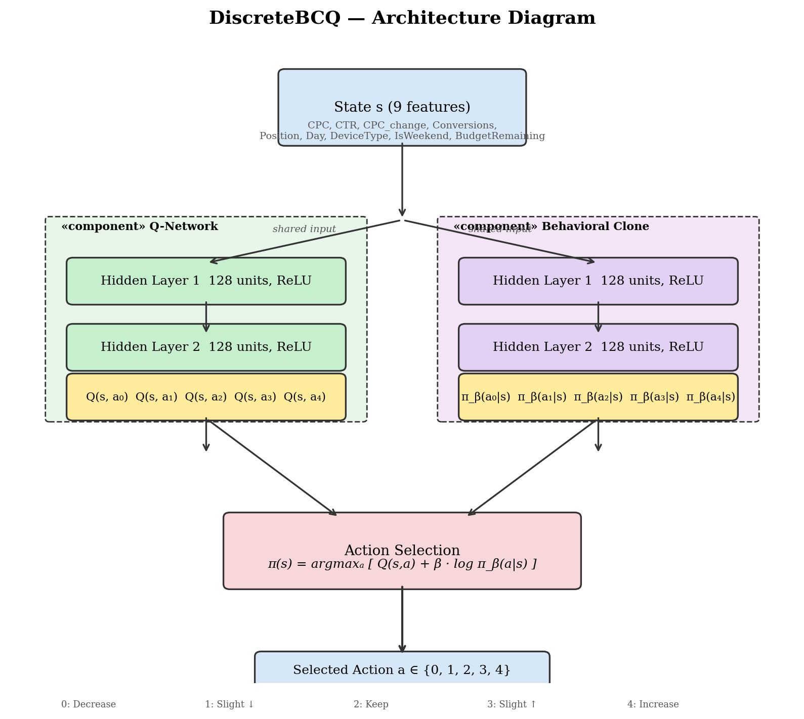

# Batch-Constrained Q-learning (BCQ) Algorithm

## Overview

BCQ (Fujimoto et al., 2019) is an offline RL algorithm designed to address the **extrapolation error** problem — the tendency of standard Q-learning to overestimate the value of out-of-distribution (OOD) actions not present in the dataset. BCQ constrains the policy to only select actions that are "batch-constrained," i.e., actions close to those seen in the training data.

The core idea: **"learn a policy that selects actions similar to the data, while maximizing the Q-function."**

## Key Concepts

### 1. Extrapolation Error

When a Q-function estimates the value of an action-pair $(s, a)$ that was never (or rarely) seen in the dataset, it can produce arbitrarily large, incorrect Q-values. The policy then exploits these erroneous estimates, leading to catastrophic failure in offline RL.

### 2. Batch-Constrained Policy

BCQ defines a policy:

$$\pi(s) = \arg\max_{a \mid G(s,a) > \tau} Q_\theta(s, a)$$

Where:
- $G(s, a)$ is a **generative model** (conditional VAE or perturbation network) trained to only produce actions similar to the dataset
- $\tau$ is a threshold controlling conservatism
- $Q_\theta$ is the standard Q-network

The policy only considers actions that pass the generative model's filter.

### 3. Discrete BCQ (DiscreteBCQ)

For discrete action spaces, BCQ simplifies significantly. Instead of a generative model, it uses an **action selection penalty**:

$$\pi(s) = \arg\max_a \left[ Q_\theta(s, a) + \lambda \cdot \log \pi_\beta(a \mid s) \right]$$

Where:
- $\pi_\beta(a \mid s)$ is the **behavioral policy** — estimated from the dataset (the empirical action distribution for each state)
- $\lambda$ (controlled by `action_flexibility`) determines how much the policy can deviate from the dataset
- The log-probability penalty prevents selecting OOD actions with erroneously high Q-values

### 4. Imitation Blending (Beta Parameter)

BCQ blends Q-learning with behavioral cloning via the **beta** parameter:

$$\pi(s) = \arg\max_a \left[ Q_\theta(s, a) + \beta \cdot \log \pi_\beta(a \mid s) \right]$$

- **$\beta = 0$**: Pure Q-learning (no constraint, can pick any action)
- **$\beta = 1$**: Moderate constraint
- **$\beta \to \infty$**: Pure behavioral cloning (always picks the most frequent dataset action)

The `beta` and `action_flexibility` parameters together control the exploration-conservatism tradeoff.

## Neural Network Architecture



*Figure: DiscreteBCQ component diagram — UML-style architecture with Q-Network and Behavioral Clone branches.*

The DiscreteBCQ network consists of **two parallel subnetworks** sharing the same state input:

### Q-Network (left branch)
- **Input**: 9-dimensional state vector (CPC, CTR, CPC_change, Conversions, Position, Day, DeviceType, IsWeekend, BudgetRemaining)
- **Hidden layers**: 2 × 128 units with ReLU activation
- **Output**: 5 Q-values, one for each discrete action $Q(s, a_0) \dots Q(s, a_4)$

### Behavioral Clone Network (right branch)
- **Input**: Same 9-dimensional state vector
- **Hidden layers**: 2 × 128 units with ReLU activation (separate weights from Q-network)
- **Output**: 5 action probabilities $\pi_\beta(a_0|s) \dots \pi_\beta(a_4|s)$ — approximating the behavioral policy from the dataset

### Action Selection Head
The final action is selected by combining both outputs:

$$\pi(s) = \arg\max_{a \in \{0\dots4\}} \left[ Q_\theta(s, a) + \beta \cdot \log \pi_\beta(a \mid s) \right]$$

Where:
- $Q_\theta(s, a)$ — Q-value estimate for action $a$ in state $s$
- $\pi_\beta(a \mid s)$ — behavioral policy probability of action $a$ in state $s$
- $\beta$ — imitation weight parameter controlling conservatism

## Our Implementation

In `compare_ppo_dqn.py`, DiscreteBCQ is used via d3rlpy:

```python
from d3rlpy.algos import DiscreteBCQ, DiscreteBCQConfig

BCQ_PARAMS = {
    'gamma': 0.99,
    'batch_size': 256,
    'learning_rate': 6.25e-5,
    'action_flexibility': 0.3,   # deviation from behavioral policy
    'beta': 0.5,                  # imitation weight
}

bcq = DiscreteBCQ(
    DiscreteBCQConfig(
        batch_size=BCQ_PARAMS['batch_size'],
        gamma=BCQ_PARAMS['gamma'],
        learning_rate=BCQ_PARAMS['learning_rate'],
        action_flexibility=BCQ_PARAMS['action_flexibility'],
        beta=BCQ_PARAMS['beta'],
    ),
    device='cpu', enable_ddp=False,
)
bcq.build_with_dataset(train_dataset)
bcq.fitter(train_dataset, n_steps=50000, n_steps_per_epoch=1000)
```

## Hyperparameter Search Methodology

### Search Script

Located in `search_bcq_params.py`. The search uses a **grid search** over three key BCQ hyperparameters:

| Parameter | Values Tested | Description |
|-----------|---------------|-------------|
| `action_flexibility` | 0.1, 0.3, 0.5, 0.7, 1.0 | Controls deviation from behavioral policy. Higher = more freedom to select OOD actions. |
| `beta` | 0.3, 0.5, 0.7, 1.0 | Imitation weight. Higher = stronger pull toward behavioral cloning. |
| `learning_rate` | 6.25×10⁻⁵ (d3rlpy default), 3×10⁻⁴ (10× higher) | Optimizer step size. |

Total: 5 × 4 × 2 = **40 combinations**.

Fixed parameters: `gamma=0.99`, `batch_size=256`, training steps = 30,000.

### Evaluation Protocol

1. **Single train/val split** (not cross-validation):
   - 80% episodes → training set
   - 20% episodes → validation set
   - Split by episode (group ID) to prevent data leakage
   - `random_state=42`

2. **Metric**: per-action mean return on the validation set:
   - For each action $a$, compute mean reward of all training samples where $a$ was taken
   - Train BCQ on the training set, predict actions on the validation set
   - Score = $mean(per\_action\_means[validation\_predictions])$

3. **Selection**: pick the combination with the highest validation score

### Limitation

The search uses a **single fixed split** — every combination is evaluated on the same validation episodes. This means the "best" parameters may be overfit to this particular split. A more robust approach (e.g., K-fold cross-validation averaging across multiple splits) was not used due to computational cost — 5-fold CV would require 200 training runs instead of 40.

### Results

The best combination found was `af=0.5, beta=1.0, lr=3e-4` with a validation score of **−0.5855** (improvement of +0.1014 over the dataset baseline of −0.6869).

However, these aggressive params proved **unstable across different random seeds** in the full budget comparison. The default d3rlpy parameters (`af=0.3, beta=0.5, lr=6.25×10⁻⁵`) showed more consistent performance across all four budget factors and were used for the final experiments.

### Budget Comparison Performance

| Budget Factor | Test AM | Improvement over Baseline |
|---------------|---------|--------------------------|
| 0.3 | -0.0713 | **+0.145** |
| 0.5 | -0.3489 | **+0.111** |
| 0.7 | -0.5106 | **+0.076** |
| 1.0 | -0.6176 | **+0.069** |

BCQ was the **only algorithm** to show positive improvement at every budget factor.

### Key Observations

- BCQ's default parameters are more stable but also more conservative (lower deviation from behavioral cloning)
- The behavioral policy in this dataset is very conservative (dominant action = "Decrease bid" / "Keep same"), which limits BCQ's upside when `af` is low
- Higher `action_flexibility` can improve performance but risks instability — requires careful tuning
- BCQ consistently learns to increase Action 4 (Increase bid) selection from ~21% to 53–72%, aligning with the per-action means

## References

- Fujimoto, S., Meger, D., & Precup, D. (2019). "Off-Policy Deep Reinforcement Learning without Exploration." *ICML 2019*. [arXiv:1812.02900](https://arxiv.org/abs/1812.02900)
- d3rlpy documentation: [DiscreteBCQ](https://d3rlpy.readthedocs.io/en/latest/references/algos.html#discrete-bcq)

## Source Files for Diagrams

| File | Format | Purpose |
|------|--------|---------|
| `bcq_uml_architecture.png` | PNG (200 dpi) | Generated UML-style architecture diagram |
| `bcq_architecture.dot` | DOT / Graphviz | Graphviz source — `dot -Tpng -Gdpi=300 bcq_architecture.dot -o bcq_architecture.png` |
| `bcq_architecture.puml` | PlantUML | PlantUML source — `plantuml bcq_architecture.puml` |
| `draw_bcq_uml.py` | Python / matplotlib | Python script generating the PNG (independent, no external tools needed) |
| `bcq_training_flow.puml` | PlantUML | Training loop sequence diagram — `plantuml bcq_training_flow.puml` |
